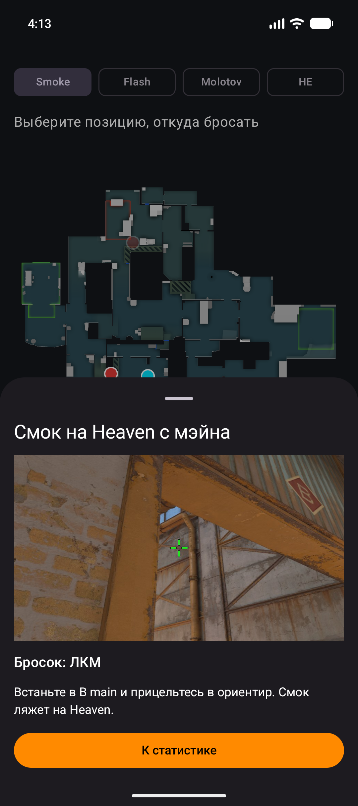
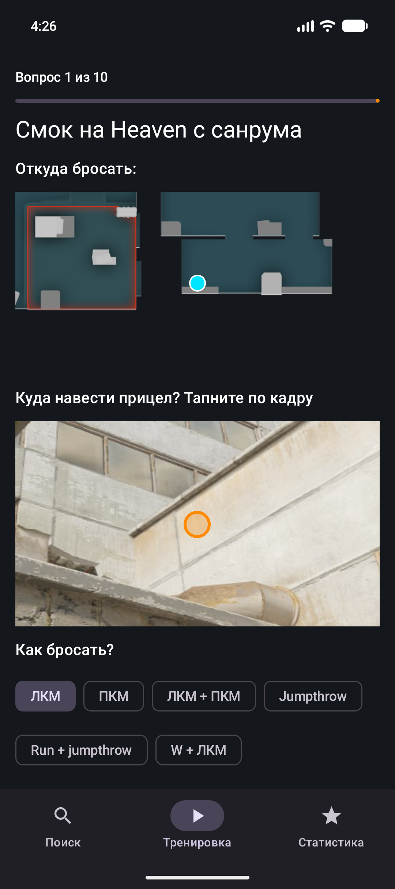
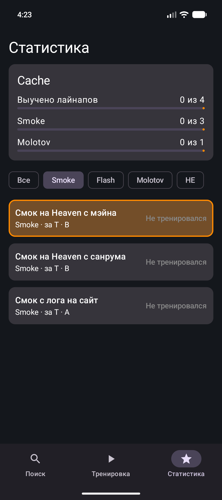
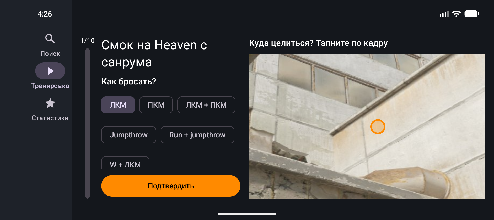

# CS2 Lineup Trainer

Справочник и тренажёр раскидок гранат для **Counter-Strike 2**. Сейчас в приложении одна карта, **Cache** (`de_cache`); карт может быть несколько, выбранная карта общая для всех разделов (как добавить новую: раздел «Новая карта» в [CONTENT_GUIDE.md](CONTENT_GUIDE.md)).

> **Неофициальный фан-проект**, не связанный с Valve. Counter-Strike и CS2 являются торговыми марками Valve Corporation. Радар карты и скриншоты из игры принадлежат Valve и используются здесь только в учебных некоммерческих целях.

Учебный проект по Android-разработке: **Kotlin + Jetpack Compose + Material 3 + ViewModel**.

## Скриншоты

<p>
  
  
  
</p>

*Поиск (инструкция «как бросать»), вопрос тренировки с поставленным маркером и выбранным броском, статистика.*

<p>
  
</p>

*Тот же вопрос после поворота телефона: маркер, выбранный бросок и вопрос сохранились (см. раздел про поворот экрана).*

## Что умеет приложение

### Поиск
Найти, как бросить гранату.
1. Выберите тип гранаты (Smoke / Flash / Molotov / HE): на радаре появятся **красные точки-цели**.
2. Тап по цели: остальные цели тускнеют, появляются **голубые точки-позиции**, откуда эту гранату туда можно бросить.
3. Тап по позиции: снизу открывается инструкция: кадр с прицелом, способ броска и описание.
4. Шаг назад: тап по пустому месту радара, свайп панели вниз или системная кнопка «назад».

Одна цель может иметь несколько позиций, а с одной позиции можно бросать на разные цели.

### Тренировка
Проверка знаний. Перед стартом выбираются сторона (T или CT) и область (A / B / Мид / все). В сессии 10 вопросов; те лайнапы, которые ещё не выучены, выпадают чаще.

В каждом вопросе показаны подпись («Смок на Heaven с санрума»), кусок радара с позицией и **кадр с позиции**. Нужно:
1. тапнуть по кадру там, куда нужно навести прицел (повторный тап переставляет маркер);
2. выбрать способ броска (клавиша Ctrl/Shift, движение шагом или разбегом в любую сторону, прыжок, кнопки мыши ЛКМ / ПКМ / ЛКМ + ПКМ);
3. нажать «Подтвердить» (кнопка активна, когда есть и маркер, и выбранный бросок).

«Попал» засчитывается, если маркер в зоне попадания **и** способ броска верный. Результат показывается всплывающей надписью, которая растворяется. В конце сессии есть итог: счёт, список вопросов и сколько лайнапов стали выученными.

Кадр вопроса каждый раз вырезается заново: показывается увеличенная часть исходного скриншота (для каждого лайнапа можно задать свой зум) со случайным небольшим сдвигом, поэтому точка прицела каждый раз оказывается в другом месте кадра.

### Статистика
Сколько лайнапов выучено (всего и по типам гранат), фильтр по типу гранаты и список лайнапов в порядке «не тренировался → учится → выучен». Лайнап считается **выученным** после трёх верных ответов подряд; если по выученному лайнапу ошибиться два раза подряд, статус снимается.

### Переходы между разделами
- Тап по лайнапу в статистике открывает его в Поиске (выбраны граната, цель и позиция, инструкция открыта).
- Кнопка **«К статистике»** в инструкции возвращает в статистику, фокусируется на этом лайнапе и коротко подсвечивает его.

### Ориентация экрана
В портрете навигация внизу, в альбоме слева (боковая панель). В альбоме у всех трёх разделов своя раскладка: Поиск (кнопки слева, радар по высоте экрана), Тренировка (полоса прогресса и три колонки с горизонтальной прокруткой), Статистика (блок карты сверху, колонки с типами гранат и лайнапами).

## Как устроено приложение

Один модуль, одна `Activity`, Navigation Compose, ручной `AppContainer` (без DI-фреймворков).

```
app/src/main/java/com/example/cs2lineuptrainer/
├── MainActivity.kt, CsApplication.kt, AppContainer.kt   точка входа и контейнер зависимостей
├── domain/    чистый Kotlin: модели, правила "выучен", подбор вопросов, проверка ответа, окно кадра
├── data/      репозитории и данные (CacheGenerated.kt создаёт скрипт из content/<карта>/)
└── ui/
    ├── AppNavigation.kt          нижняя панель / боковая панель и NavHost
    ├── components/               переиспользуемые Composable
    ├── explorer/ trainer/ stats/ экраны и их ViewModel
    └── theme/                    тёмная Material 3 тема
```

- **UI отделён от состояния.** У каждого раздела есть `...Screen` (берёт состояние из `ViewModel`) и «глупый» `...Content` (только рисует то, что ему передали, и сообщает о нажатиях).
- **`ViewModel`:** `ExplorerViewModel`, `TrainerViewModel`, `StatsViewModel`, состояние отдаётся как `StateFlow` и читается через `collectAsStateWithLifecycle()`.
- **Прогресс** хранится в `ProgressRepository` (интерфейс; сейчас `InMemoryProgressRepository`), он общий для тренировки и статистики и живёт в `AppContainer`, а не в `ViewModel`. Замена на постоянное хранилище (DataStore/Room) затронет одну строку в `AppContainer`.
- **Логика проверена тестами**, потому что вынесена в чистые функции: `LineupProgress.afterAttempt` (правила «выучен»), `QuestionPicker` (взвешенный подбор вопросов), `checkAnswer`, `FrameWindow`, `computeStats`.

### Переиспользуемые Composable (`ui/components/`)
`MapRadar` (радар с точками, используется в Поиске), `RadarClip` (увеличенный кусок радара), `TapTargetImage` (кадр с маркером), `GrenadeTypeSelector`, `ThrowTypeSelector` (способ броска: клавиша, восьмиугольник движения, прыжок, кнопки мыши), `OptionChips` (универсальный выбор из списка: сторона, область, фильтры), `LearnedProgress`, `VerticalProgressBar`, `LineupMediaView` (картинка или GIF).

## Соответствие требованиям задания

| Требование | Где в проекте |
|---|---|
| Kotlin + Jetpack Compose, Material 3, единый стиль | весь UI; тема в `ui/theme/` |
| Не менее 3 переиспользуемых Composable | список выше, `ui/components/` |
| `Row`, `Column`, `Box` | `MapRadar` и `TapTargetImage` (`Box`), экраны и карточки (`Row`, `Column`) |
| `LazyColumn`, `Card`, `Text`, `Image` | список лайнапов и итог тренировки (`LazyColumn` + `Card`), радар и кадры (`Image`) |
| Не менее 2 осмысленных взаимодействий | выбор гранаты/цели/позиции, фильтры, тап по кадру + выбор броска, переходы между разделами |
| Input-компоненты | `Button`, `FilterChip` |
| UI обновляется по действиям | `StateFlow` + `collectAsStateWithLifecycle()` |
| `remember` и `rememberSaveable` | см. следующий раздел |
| Не менее одного `ViewModel`, UI отделён от состояния | три `ViewModel`, пары `Screen` / `Content` |
| Поведение состояния при пересоздании Activity | следующий раздел |

## Состояние при повороте экрана: `remember`, `rememberSaveable`, `ViewModel`

При повороте телефона `Activity` **пересоздаётся**, и состояние ведёт себя по-разному в зависимости от того, где оно хранится:

| Где хранится | Переживает перерисовку | Переживает поворот | Переживает закрытие процесса | Пример в проекте |
|---|---|---|---|---|
| `remember` | да | **нет** | нет | всплывающая надпись «Попал / Не попал» (`FeedbackBanner`), положение прокрутки вопроса |
| `rememberSaveable` | да | **да** | да (небольшие данные) | поставленный маркер и выбранный способ броска до «Подтвердить» (`TrainerQuestionContent`, маркер сохраняется своим `Saver`) |
| `ViewModel` | да | **да** | нет | сессия тренировки и её результаты, выбор в Поиске, фильтр статистики |

Коротко:
- **`remember`** хранит значение, пока composable остаётся в композиции. При повороте композиция строится заново, и значение сбрасывается. Подходит для временного: анимаций, прокрутки.
- **`rememberSaveable`** то же, но значение дополнительно сохраняется в `savedInstanceState`, поэтому переживает поворот и даже убийство процесса системой. Подходит для небольшого пользовательского ввода (его нужно уметь положить в `Bundle`; для своей точки написан `Saver`).
- **`ViewModel`** переживает пересоздание `Activity`, хранит состояние экрана и логику. Но не переживает смерть процесса (для этого нужен `SavedStateHandle` или постоянное хранилище).

**Как увидеть это в приложении:**
1. Откройте «Тренировка» → «Начать»: поставьте маркер на кадр и выберите способ броска.
2. Поверните телефон. Маркер и выбранный бросок на месте (`rememberSaveable`), вопрос и счёт тоже (`ViewModel`).
3. Если повернуть в тот момент, когда на экране висит надпись «Попал / Не попал», она исчезнет (`remember`), хотя ответ уже засчитан.
4. В Поиске выберите гранату, цель и позицию и поверните телефон: выбор и открытая инструкция сохраняются (`ViewModel`).

Важная деталь: ключ, под которым `rememberSaveable` хранит значения, зависит от положения composable в дереве. Поэтому `NavHost` в `AppNavigation` стоит в одном и том же месте в портрете и в альбоме (иначе после поворота сохранённое значение не находилось бы).

**Прогресс обучения** (`ProgressRepository`) хранится в памяти процесса: он переживает поворот, но при полном закрытии приложения обнуляется. Сохранение на диск вынесено за рамки текущей версии.

## Как запустить

Требуется Android Studio, поддерживающая Android Gradle Plugin 9.4 (проект создан в актуальной версии Studio), эмулятор или телефон на Android 8.0+ (`minSdk 26`).

1. Откройте в Android Studio папку проекта (ту, где лежат `gradlew` и `settings.gradle.kts`).
2. Дождитесь Gradle Sync (скачиваются Gradle 9.6, Kotlin 2.2.10, Compose BOM 2026.02.01).
3. Выберите эмулятор или устройство и нажмите **Run ▶**.

Из консоли:

```bash
./gradlew :app:assembleDebug        # сборка
./gradlew :app:testDebugUnitTest    # unit-тесты
```

Основные версии: Kotlin 2.2.10, Compose BOM 2026.02.01 (Material 3), Navigation Compose 2.10.2, Lifecycle 2.11.0, Coil 3.3.0 (только для анимированных GIF).

## Как добавить свои лайнапы

Лайнапы не пишутся в код вручную: скриншоты и описание кладутся в папку `content/`, а скрипт делает картинки и Kotlin-код.

```bash
pip install pillow
python tools/convert_lineups.py            # сконвертировать
python tools/convert_lineups.py --check    # только проверить
```

Из одного скриншота (прицел наведён в нужную точку и находится в центре кадра) скрипт делает кадр для инструкции (центральная половина с нарисованным прицелом) и целый кадр без прицела для тренировки, а также создаёт `data/CacheGenerated.kt`. Игровые координаты (`getpos`) переводятся в положение на радаре по параметрам карты (`de_cache.txt`).

Подробный формат файла `content/<карта>/lineups.txt`, правила именования и подготовка скриншотов описаны в [CONTENT_GUIDE.md](CONTENT_GUIDE.md). Исходные скриншоты (`content/<карта>/screens/`) в репозиторий не входят из-за размера; готовые картинки и сгенерированный код в репозитории есть, поэтому приложение собирается без запуска скрипта.

## Тесты

102 unit-теста (`app/src/test`), без эмулятора: правила «выучен», подбор вопросов, проверка ответа и окно кадра при любом зуме, перевод координат на радар, целостность данных лайнапов, поведение всех трёх `ViewModel` (включая переходы между разделами).

## Ограничения и планы
- Одна карта (Cache), данные заданы в коде/скриптом, а не загружаются из сети.
- Прогресс хранится в памяти (см. выше).
- Зона попадания сейчас круг вокруг правильной точки. Подготовлен интерфейс `HitMask` для зоны из картинки-маски.
- Точки на радаре построены по игровым координатам и могут слегка отличаться от реального положения.

## Источники
- Радар и параметры карты (`pos_x`, `pos_y`, `scale`): репозиторий [MurkyYT/cs2-map-icons](https://github.com/MurkyYT/cs2-map-icons).
- Скриншоты лайнапов сделаны автором в игре.
